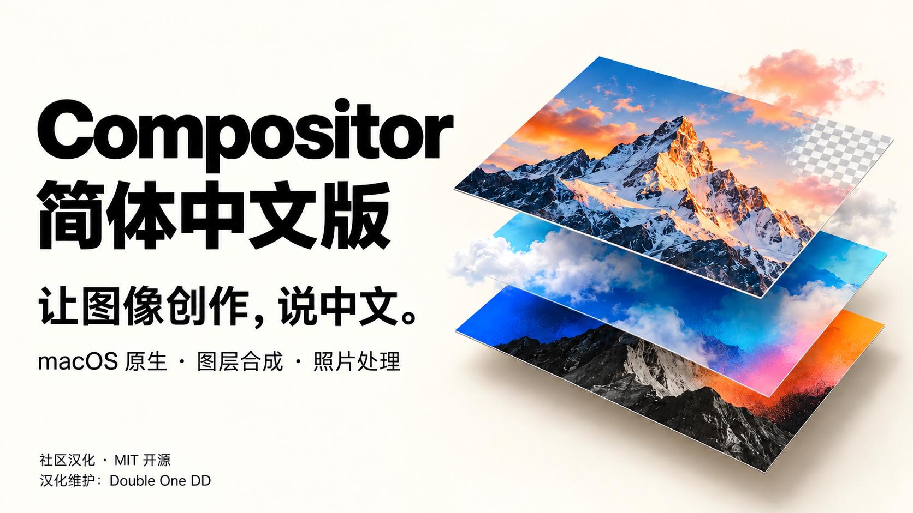
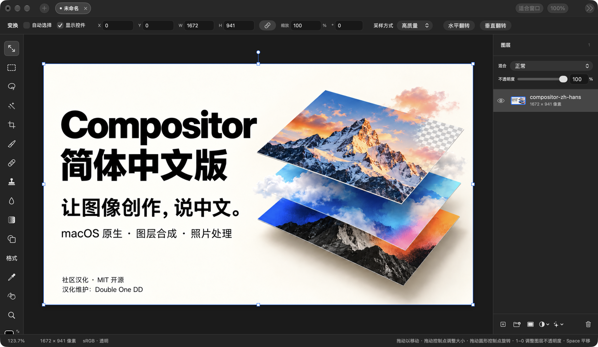

# Compositor 简体中文版

**让图像创作，说中文。**

汉化维护：[Double One DD](https://github.com/wangyinhe3939)



Compositor 是一款面向图像合成与照片后期的 macOS 原生图像编辑器。本仓库基于 [Robbie Tilton / Wonder Assembly 的 Compositor](https://github.com/robbietilton/Compositor)，由 **Double One DD** 独立维护简体中文界面、帮助提示和相关排版修正。

本次汉化包含 **1,235 条中文资源**，保留英文回退与原有编辑工作流。适合希望用中文进行图层合成、图片修饰和照片调色的 Apple 芯片 Mac 用户。

> 本项目是社区汉化分支，非原作者官方中文发行版。保留原项目版权与 MIT 许可。安装包使用 ad-hoc 签名，未经过 Developer ID 签名或 Apple 公证；首次打开请参照安装说明。

## 下载安装

**[下载 DMG 安装包](https://github.com/wangyinhe3939/Compositor-zh-Hans/releases/download/v1.5-zh-Hans.1/Compositor-1.5-zh-Hans.1-arm64.dmg)** · [ZIP 备用下载](https://github.com/wangyinhe3939/Compositor-zh-Hans/releases/download/v1.5-zh-Hans.1/Compositor-1.5-zh-Hans.1-arm64.zip) · [最新版本与校验文件](https://github.com/wangyinhe3939/Compositor-zh-Hans/releases/latest)

适用于 **macOS 26.0 及以上、Apple 芯片 Mac**，无需安装 Xcode。打开 DMG，把 `Compositor.app` 拖入 Applications（应用程序）即可安装。已有同名 App 时请先退出，再按需替换。

本包未公证。确认来源并信任项目后，可按 [完整安装说明](docs/安装说明.md) 在“系统设置 → 隐私与安全性”中选择“仍要打开”。App 跟随系统语言，也可在系统设置中单独设为简体中文。

## 真实界面



上图来自汉化 App 的实际窗口，展示中文变换工具栏、图层面板和状态提示。画布载入的是本项目的 AI 生成宣传图，不代表山景图像由 Compositor 生成。

## 可以做什么

| 工作流 | 主要能力 |
| --- | --- |
| 图层合成 | 图层与分组、混合模式、图层蒙版、剪贴蒙版、调整图层和可编辑图层效果 |
| 图片修饰 | 画笔、修复、仿制图章、模糊、涂抹、液化、渐变与形状工具 |
| 照片调色 | 色阶、曲线、色相／饱和度、曝光、色彩平衡与 Camera Raw 调整面板 |
| 文字排版 | 可编辑文字、多行段落框、字体、字号、对齐及间距控制 |
| 选区与变换 | 矩形／椭圆选区、套索、魔棒、主体选择、裁切、缩放、旋转与自由变形 |
| 文件处理 | 多项目标签页，常见图片与 RAW 导入，PSD／PSB 导入转换报告，PNG／JPEG／单页 PDF 导出 |
| 效率操作 | 命令搜索、可调整快捷键、标尺与参考线，以及可供脚本读写的 `.comp` 工程格式 |

PSD／PSB 导入存在格式与效果兼容边界；导入前请阅读转换报告，不应假定与 Photoshop 完全等价。

## 这次汉化改了什么

| 资源 | 条目数 | 范围 |
| --- | ---: | --- |
| `Localizable.strings` | 913 | 菜单、工具栏、图层、调整面板与操作名称 |
| `Help.strings` | 245 | 工具提示与帮助说明 |
| `Messages.strings` | 71 | 错误、导入和文件操作消息 |
| `InfoPlist.strings` | 6 | 系统使用说明 |
| **合计** | **1,235** | 简体中文资源 |

- 增加统一的本地化读取与英文回退，界面跟随 macOS 为 App 设置的语言。
- 补齐动态操作名称，包括“撤销涂抹”和“撤销液化”。
- 本地化 PSD 空白图层名称的默认显示。
- 修正“画布尺寸”说明文字的中文截断，使说明可以自然换行。
- 保持文档存储值、用户输入、内部快捷键标识和工程格式不变。

这是资源与已检查界面的覆盖说明，不代表所有运行路径均已完成人工验收，也不承诺完全无漏译。

## 系统要求

- **macOS 26.0 或更高版本**
- **Apple silicon（Apple 芯片）Mac**
- 从源码构建需要 **Xcode 26 或更高版本**

## 从源码运行

```bash
git clone https://github.com/wangyinhe3939/Compositor-zh-Hans.git
cd Compositor-zh-Hans
open Compositor.xcodeproj
```

在 Xcode 中选择 **Compositor** scheme，运行目标选择 **My Mac**，并按自己的开发环境设置 Signing & Capabilities。工程保留了上游签名配置，不代表已提供原作者的证书或签名权限。

也可在仓库根目录进行不带签名的编译检查：

```bash
xcodebuild -project Compositor.xcodeproj -scheme Compositor -configuration Debug -destination 'platform=macOS,arch=arm64' -derivedDataPath .build_tmp/DerivedData -clonedSourcePackagesDirPath .build_tmp/SourcePackages -packageCachePath .build_tmp/PackageCache -onlyUsePackageVersionsFromResolvedFile CODE_SIGNING_ALLOWED=NO COMPILER_INDEX_STORE_ENABLE=NO build
```

命令行构建产物位于 `.build_tmp/DerivedData/Build/Products/Debug/Compositor.app`。此命令仅验证编译，不保证产物可直接启动。实际开发运行请使用 Xcode 配置签名后 Run。

社区安装包使用 `scripts/build-community.sh` 生成优化的 Release 构建，关闭调试动态库与覆盖率记录，并映射构建路径。脚本只负责构建；发布前还需移除本地链接符号、保留依赖许可证、签名和打包验证。普通用户可直接使用上方安装包。

### 选择中文

在 macOS **系统设置 → 通用 → 语言与地区 → 应用程序**中，将已构建并可运行的 Compositor 的语言设为“简体中文”，然后重新打开 App。开发调试时，也可在 Xcode 的 Edit Scheme → Run → Options 中将 App Language 设为简体中文。

### 更新来源

本分支已停用上游 Sparkle 自动更新器并移除上游更新源。“检查更新…”会打开 [汉化版 Releases](https://github.com/wangyinhe3939/Compositor-zh-Hans/releases/latest)，下载新包后手动替换 App。

原项目网站和 Homebrew cask 分发的是上游版本。仓库保留的 `scripts/release.sh` 与 `scripts/publish.sh` 属于上游发行流程，其中发布脚本默认指向上游仓库；请勿用它们发布此汉化分支。

## 验证范围

已完成中文资源解析、英文回退、格式占位符与源码构建检查；本地实际查看了中文主菜单、导出、图像／画布尺寸、快捷键、Camera Raw 初始面板，以及涂抹／液化撤销名称。已确认画布尺寸说明的中文换行修正。

本次安装包另已完成 Release 构建、签名完整性与权限核对、DMG 校验、ZIP 解包启动及中文窗口检查。两种归档中的 App 文件与符号链接逐项一致，并附带 SHA-256 校验文件。

尚未完成所有功能的完整回归、多设备测试和所有系统语言组合检查。PSD 默认图层名称的修正通过源码与构建核验，未单独完成真实 PSD 导入验收。GitHub Actions 结果请以仓库的实际运行记录为准。

## 参与改进

欢迎提交 [Issue](https://github.com/wangyinhe3939/Compositor-zh-Hans/issues) 反馈漏译、术语和中文排版问题。请附上 macOS 版本、触发步骤、英文原文或界面位置，以及不含私人内容的截图。

中文资源位于 `Compositor/Resources/zh-Hans.lproj/`，读取逻辑位于 `Compositor/Resources/L10n.swift`。修改译文时保留格式占位符，不要翻译用于文档存储的枚举值、内部标识或用户内容。

开发说明：[工程格式](docs/project-format.md) · [通过脚本编写工程](docs/writing-comp-files.md)

## 介绍与宣传素材

[介绍文案与素材说明](docs/宣传文案.md) · [宣传图](docs/media/compositor-zh-hans.png) · [真实界面截图](docs/media/editor-zh-hans.png)

宣传图由内置 imagegen 工具生成，是图层合成主题的概念视觉；界面截图由汉化 App 实际运行取得。

## 致谢与许可

- 原项目：[robbietilton/Compositor](https://github.com/robbietilton/Compositor)
- 原作者与版权：Robbie Tilton / **Wonder Assembly LLC**
- 简体中文汉化与维护：**[Double One DD](https://github.com/wangyinhe3939)**
- 许可：[MIT License](LICENSE)，保留原始版权声明。

本仓库起始于上游源码快照，保留本地基线与汉化变更记录；它是独立维护的源码仓库，不冒充上游完整提交历史。原项目附带的参考图、打包背景和其他资源保留原始身份，本次宣传素材未复用其中的影视画面或 Photoshop 参考截图。
